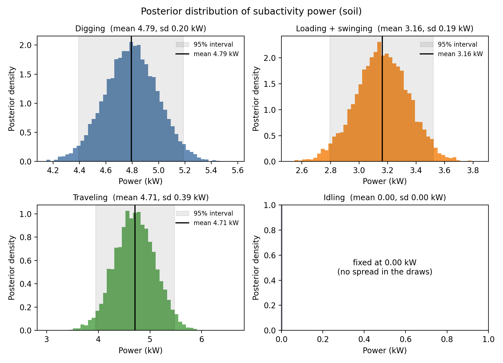

# Posterior distribution of subactivity power (soil)

Posterior of the mean power of each CEV subactivity from the Bayesian linear regression (8000 draws). The draws are in `Approach 2/data/input_data/posterior_draws.csv` (one column per subactivity, in kW). Controllers plan with these draws (CE-MPC: posterior mean, SB-MPC: scenarios built from the draws).

| Subactivity | Mean (kW) | Std (kW) | 2.5% (kW) | Median (kW) | 97.5% (kW) |
|---|---|---|---|---|---|
| Digging | 4.793 | 0.201 | 4.394 | 4.795 | 5.187 |
| Loading + swinging | 3.162 | 0.185 | 2.795 | 3.162 | 3.520 |
| Traveling | 4.709 | 0.392 | 3.947 | 4.708 | 5.474 |
| Idling | 0.000 | 0.000 | 0.000 | 0.000 | 0.000 |

Individual plots: [Digging](posterior_dig.png), [Loading + swinging](posterior_load.png), [Traveling](posterior_travel.png), [Idling](posterior_idle.png).

Regenerate with `python "Bayesian Regression/posterior_plots.py"` from the repo root.
